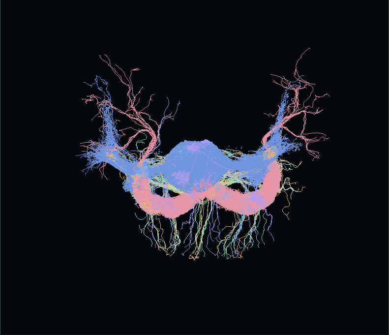

# ConnectomeTwin

An interactive companion to **Reconstruction differences rival individual differences in the fly compass connectome and break trained circuit models** by Md Ali Ashraf Yad and Nazifa Tabassum Nabila (2026).

Compare reconstructions of the same fly compass circuit, watch a trained network remember a heading, and see what happens when its wiring changes. The five-step tour covers detector differences, transplantation, and cell-type gain refitting.



The default 3D view now shows **real anatomical skeletons for all 433 FlyWire neurons**, with a 2.6 MB fast overview and optional 10.2 MB full detail. Fine terminal twigs are hidden in the overview; this screenshot shows full detail. [Full interface screenshot](connectometwin/docs/images/anatomy-full.png). Use **2D ring** for the original graph layout.

## Instrument interface

The Stitch-inspired frontend puts real anatomy beside experiment controls, with live heading telemetry, neuron-family filters, an inspector, fullscreen, and the five-step guided story. It supports light/dark themes and phone layouts, uses local assets, and preserves the simulation engine. [Interface screenshot](connectometwin/docs/images/stitch-explorer.png).

WebGL 2 and browser graphics acceleration are required for 3D. If graphics initialization fails, the scientific controls and 2D ring remain available.

## Run locally

No build step or JavaScript dependencies are required. From the repository root:

```sh
cd connectometwin/web
python -m http.server 8000
```

Open `http://localhost:8000/`. Use `python3` if your system names Python 3 that way. Open `self-check.html` on the same server to run the 46 model reference cases in your browser. All application assets and data are local.

## Controls and accessibility

- Theme defaults to your system's `prefers-color-scheme`; choose System, Light or Dark to override. Explicit choices persist locally.
- Use Tab to reach controls, and the native arrow keys for selects and sliders. Outside form controls, **Space** plays/pauses and **R** restarts.
- In 3D, drag to orbit, scroll/pinch to zoom, arrows to pan, **Home** to reset the camera, and **[ / ]** to inspect neurons. In 2D, **Left/Right** inspect neurons and **Home/End** jump to the first/last. Neurons can also be selected by clicking/tapping.
- Playback starts paused when reduced motion is requested. Error values are available as text alongside Canvas plots.
- The layout supports phones and laptops. Readability and keyboard checks are documented in the [development README](connectometwin/README.md).

## GitHub Pages

The [Pages workflow](.github/workflows/pages.yml) validates the model and packages **only `connectometwin/web/`** as the site's root. It runs on pushes to `main` affecting the site or tests, and can be started manually.

1. In the repository, open **Settings → Pages → Build and deployment → Source** and select **GitHub Actions**.
2. Open **Actions → Validate and deploy ConnectomeTwin → Run workflow** if the push did not already trigger it.
3. After a successful deployment, use the URL shown by the `github-pages` environment. The expected project URL is `https://donti507.github.io/connectometwin/`.

Pages must be enabled for the repository/account, and repository policies must permit Actions and Pages deployment. Do not select the branch-based `/docs` option: the workflow publishes the web folder directly, preserving relative JSON, module and worker URLs. Workflow preparation and a successful Git push alone do not establish that the site is live.

## Validation and performance

From the repository root, with Node 24:

```sh
for test in connectometwin/tests/*.test.mjs; do node "$test" || exit; done
```

Optional browser checks require Playwright, Chromium and the local server:

```sh
node connectometwin/tests/browser.cjs
node connectometwin/tests/release.cjs
```

Wiring JSON is fetched and compiled only when selected as A/B, then cached. Startup loads two wirings instead of seven. Background workers calculate 16-heading benchmarks without blocking animation; stale selection/worker results are ignored. Connection layers are cached, with the strongest 1,200 edges shown by default.

In the **2D ring view**, headless Chromium at 1366 px with **4× CPU throttling**, the largest wiring (33,783 edges) measured **58.3 fps** with default edges and **60.4 fps** with all edges; 95th-percentile frame gaps were 25.2 ms and 21.5 ms. This is a repeatable slower-CPU proxy for a mid-range laptop, not a physical laptop benchmark or a guarantee for every device. Run `release.cjs` to measure your machine. Checks also cover 320, 390, 768 and 1366 px layouts, theme persistence, Canvas colors, keyboard operation, text contrast, lazy-loading races and reduced motion.

## Citation and data

[Paper: arXiv:2610.29205](https://arxiv.org/abs/2610.29205) · [Study code and results: ChessFly](https://github.com/donti507/chessfly)

```bibtex
@article{yad2026reconstruction,
  title = {Reconstruction differences rival individual differences in the fly compass connectome and break trained circuit models},
  author = {Yad, Md Ali Ashraf and Nabila, Nazifa Tabassum},
  journal = {arXiv preprint arXiv:2610.29205},
  year = {2026},
  doi = {10.48550/arXiv.2610.29205},
  url = {https://arxiv.org/abs/2610.29205}
}
```

Connectome data: **FlyWire, Janelia FlyEM (male CNS and hemibrain), and BANC**. Imaging context: **DANDI 000289**, Basnak et al. (2025). This page simulates the model; it does not replay imaging recordings. Please cite the original datasets and respect their licenses.

See the [development README](connectometwin/README.md) for the model, experiments and numerical source notes, and the [roadmap](connectometwin/docs/ROADMAP.md) for implementation status.

## Real anatomical 3D view

The project owner extracted all 433 model neurons from the FlyWire-783 Zenodo
skeleton archive and supplied the 24.4 MB subset. The importer maps exact string
root IDs, reconstructs SWC parent links, converts nanometers to micrometers and
simplifies degree-two paths at 0.25 µm tolerance. All branch points, endpoints
and tree connectivity are retained. The full 511,265 segments are packed
into a **10,233,968-byte bundle**, with a verified SHA-256 and original-data
attribution. There are no external anatomy requests at runtime.

Open the page normally for real FlyWire anatomy. The default fast overview
(130,607 segments; 2,620,808 bytes) omits terminal twigs shorter than 5 µm and
simplifies remaining paths at 0.75 µm. Choose **Full branches** to load the
complete 0.25 µm geometry. Both levels contain all 433 neurons. Use `?view=ring` to start in the
2D view, or `?view=ring&geometry=topology` for explicit non-anatomical layout
experiments. Anatomy is shared between Princeton, Buhmann and unfiltered FlyWire
only by exact neuron ID. Other flies retain the topology view until their own
matching anatomy is imported.

GPU geometry is batched and backed by typed arrays. Activity updates change only the affected neuron color ranges; paused scenes stop redrawing once activity/camera damping
settle. Only requested A/B wiring JSON is loaded. The skeleton bundle is fetched
once and reused across matching FlyWire variants. WebGL-unavailable browsers
retain the 2D fallback. The simulation engine and reference values are unchanged.

[Data provenance, reproducible import and format](connectometwin/docs/3D-ANATOMY.md)
· [CC BY 4.0 attribution and modifications](connectometwin/web/data/anatomy/LICENSE.md).

Software-only WebGL was measured at roughly 16–17 fps during overview rotation
in headless Chromium; hardware acceleration is recommended for 3D. This is
separate from the 2D frame-rate measurements above. Full detail has a higher GPU
cost; the overview, family filters and 2D ring remain available for slower devices.
