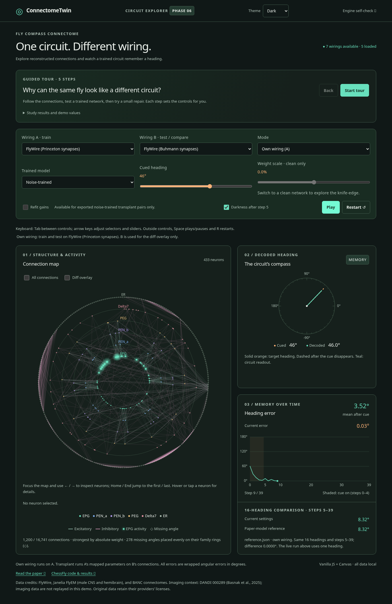

# ConnectomeTwin

Interactive companion to *Reconstruction differences rival individual differences in the fly compass connectome and break trained circuit models* (Yad & Nabila 2026, [arXiv:2610.29205](https://arxiv.org/abs/2610.29205)).

Compare two reconstructions of the same fly circuit, see which connections changed, and watch a trained network hold, or lose, a heading on each wiring.

Status: Phases 0–6 implemented; Pages deployment must succeed before claiming the site is live. See `docs/ROADMAP.md`.

## Simulation engine (Phase 2)

`web/js/engine.mjs` is a browser-native ES module with no build step or runtime
packages. It stores sparse weights in presynaptic-row CSR and uses typed arrays.
`Simulation.step()` advances one model timestep (two microsteps); its activity
buffer is reused on subsequent steps. `reset(theta)` clears state for a new cue.
`transplant()` maps source parameters onto target neurons and can apply a refit's
target-cell-type gain offsets. `simulate()` evaluates the 40-step reference task.

Run the validation gate with Node.js (tested with Node 24):

```sh
node connectometwin/tests/engine.test.mjs
```

This checks all 14 own-wiring, 28 weight-scale, and 4 transplant references across
16 headings, with a ±0.05° mean-error tolerance, plus final decoded headings,
CSR direction, reset, parameter mapping, and all five exported refit results.
The Phase 3 viewer uses this engine unchanged.
Missing display angles are `null`; visualization must handle them explicitly.

## Gain refitting

With NumPy and CPU PyTorch installed, run from the repository root:

```sh
OMP_NUM_THREADS=2 MKL_NUM_THREADS=2 OPENBLAS_NUM_THREADS=2 \
  python connectometwin/scripts/refit_export.py
```

This runs all five pairs, 600 Adam updates per pair, and writes
`connectometwin/web/data/refits.json`. Use `--data-dir PATH` to select another
export directory. The script fixes the training seeds; floating-point results
can vary by PyTorch version and hardware. This is a full training run, not a
smoke test.

## Static Canvas explorer (Phase 3)

From the repository root, serve the page without a build step:

```sh
cd connectometwin/web
python -m http.server 8000
```

Open the server's `index.html`. Return to the repository root before running the test commands below. The page uses vanilla JavaScript, Canvas, system
fonts and local JSON only; no CDN or external network requests are required.
Select wiring A/B, own or transplant mode, and clean or noise-trained parameters. Runs animate at
browser refresh rate, targeting ten model timesteps per second and smooth EPG glow
between steps. Slow renderers stretch playback rather than skip model steps. Playback stops after step 39; use Replay or Restart for a new run.
The error plot shows absolute wrapped error in degrees, with a mean over steps
5–39 only. Display smoothing affects glow only, never model state or error.

Connections are cached on an offscreen canvas and show the strongest 1,200 by
absolute weight by default. “All connections” shows every edge. Same-fly diffs
are oriented from wiring A to wiring B: added green, removed red,
changed gold with width proportional to the magnitude of the log change ratio.
Diffs use their own 1,200-edge strongest-weight limit unless all connections are
enabled; counts below the map describe both layers. Diff overlays are disabled across different flies; transplantation remains available. Missing angles use evenly spaced diamond markers on the
appropriate family ring; EPGt shares the EPG ring. Hover a neuron for details.

Open `self-check.html` to run all 46 engine reference cases directly in a browser.
For local checks:

```sh
node connectometwin/tests/engine.test.mjs
node connectometwin/tests/view.test.mjs
node connectometwin/tests/run.test.mjs
node connectometwin/tests/tour.test.mjs
node connectometwin/tests/data.test.mjs
# Optional: requires Playwright, Chromium, and the static server above.
node connectometwin/tests/browser.cjs
node connectometwin/tests/release.cjs
```

The browser check covers all wirings, diff direction, connection limits,
playback, the numerical run result, Canvas refresh, mobile sizing and the
browser reference gate. Set `CHROMIUM_PATH` or `CONNECTOMETWIN_URL` to override
the test browser executable or server address. The guided tour is described below.

## Experiment controls (Phase 4)

Both A and B offer all seven versions. **Own wiring** trains/tests on A; B only
selects the same-fly diff comparison. **Train on A, test on B** maps A's trained
parameters onto B through `maps.json` and uses B's connections, neuron families,
readout positions and displayed activity. Selecting A=B uses an identity map.

The **weight scale** slider multiplies connection weights by 0.98–1.02 in 0.1%
increments for clean networks. It resets to zero and disables for noise-trained
networks. The unscaled own-wiring reference is shown alongside the slider to
make the knife-edge visible (FlyWire clean: approximately 0.58° at baseline,
21.67° at +1%, averaged over 16 headings).

**Refit gains** is available only for the five directed noise-trained pairs in
`refits.json`: offsets are added to transplanted presynaptic log gains by target
cell type. It clears when changing to an unsupported pair, own wiring or a clean
network. The full refits were trained on the noise networks, so they are never
silently applied to clean parameters.

**Darkness after step 5** is enabled by default: the cue is present at steps 0–4,
then removed for steps 5–39. Unchecking it leaves the cue on for all 40 steps.
Changing experiment settings or the cue angle restarts the run; Play/Pause stops
or resumes the same model state, and Restart clears it.

The instantaneous error and running mean over steps 5–39 describe the displayed
single-heading trial. A separate benchmark computes the current configuration's
mean over the exact 16 headings in `reference.json`. Its paper-model reference
comes from the corresponding own, scaled, or transplant entry, or the clearly
labelled refit export when applicable. Values missing for intermediate scales,
unexported pairs or continuous cues say **Not available**; no paper number is
invented. Refit exports are generated results, not additional published claims.

`tests/run.test.mjs` exercises UI configuration resolution against every supplied
reference case and refit, all 49 directed A/B choices, disabled-control state,
and darkness semantics. The browser check also exercises transplant/refit mode,
clean scaling, unsupported-pair resets and the live numerical error displays.

## Guided story (Phase 5)

Choose **Start tour** above the controls, then use Next/Back through five steps:
same fly and two detectors; added/removed/changed connections; own-wiring memory;
the same noise-trained network transplanted to Buhmann wiring; and cell-type
refitting. Each step restores the complete preset, including cue angle, scale,
darkness, edge layers and playback. Structural steps pause; model steps replay.
Step 5 offers detector and filtering-only examples without adding a sixth step.
Changing experiment controls exits the tour so its captions cannot describe a
manual configuration as if it were still the preset. Pause/Replay/Restart remain
available within the tour. Finish or Explore freely retains the current run.

Tour counts and demo errors come directly from the shipped `diffs.json`,
`reference.json` and `refits.json`. The displayed failure is the noise-trained
Princeton → Buhmann transplant (8.32° own → 85.47° transplant → 15.92° refitted).
FlyWire uses 19 refitted target types, despite the study's general description
of “about thirty” gains. The filtering-only example uses male CNS → neuPrint,
32 gains, and improves from 20.94° to 5.56° (own wiring: 8.74°).

The expandable **Study results and demo values** table separately quotes the
study's noise-level-0.5, neuron-gain, seed-0 results: 8.54° own, 84.11° detector
transplant, 15.59° detector refit; male-CNS filtering 20.23° → 5.67°.
Source: [`stage4d_transplants.csv`](https://github.com/donti507/chessfly/blob/6441621435deb66780fee950914108bbeda3051e/new_study/results/stage4d_transplants.csv)
at study repository commit `6441621`. Its `stage4d_final.py` evaluates 2,000
random headings, whereas this demo uses the 16 fixed reference headings and
rounded exports. These are seed-specific examples, not cross-seed averages.
The page does not download the study results at runtime.

The footer links the paper and ChessFly source and credits FlyWire, Janelia
FlyEM, BANC and DANDI 000289 (Basnak et al., 2025). DANDI supplies the study's
imaging context; this page simulates the model and does not replay imaging data.
Original datasets retain their providers' licenses.

`tests/tour.test.mjs` checks all five presets, source-derived captions, numerical
benchmarks and the filtering example. The browser test walks Next/Back, switches
step-5 examples, finishes/restarts/exits through manual changes, and checks
credits, source links and mobile layout.

## Themes, loading, accessibility and deployment (Phase 6)



See the [repository README](../README.md) for local startup, the BibTeX citation,
keyboard commands, performance measurements and Settings → Pages instructions.
The workflow at `.github/workflows/pages.yml` uploads `connectometwin/web/` as the
Pages artifact root after running every `tests/*.test.mjs` suite with Node 24.
It requires no build and performs no automatic edits to the study repository or
external posts. Deployment and live-site verification are separate from setup.

`theme.mjs` follows system light/dark changes, with a persisted explicit override;
CSS has a system-aware fallback before JavaScript initializes. Canvas layers use
the same theme tokens. Text is larger, controls have explicit/native labels and
visible focus, and the map offers keyboard/touch details as well as hover.
A skip link, textual errors, completion announcement and reduced-motion startup
are included. Release checks verify core text-token contrast ≥4.5:1, but this is
not a claim of a complete accessibility audit.

`data.mjs` loads only selected A/B wirings, caches in-flight promises and compiled
CSR arrays, and evicts failures so they can be retried. Each asynchronous run has
a request ID; older selections cannot replace the latest run. Only metadata and
the default FlyWire pair are loaded initially. Benchmarks run in a module worker
and are cached by model configuration; changing settings cancels old workers.
The browser reference self-check intentionally loads all seven wirings because
it tests every model. The engine and numerical data remain unchanged.

`release.cjs` tests system/explicit theme persistence, both Canvas palettes,
contrast tokens, keyboard controls and details, accessible input names, loading
races/cache, reduced motion, phone/laptop overflow and 4×-throttled animation.
It captures the real application screenshot; regenerate it with:

```sh
SCREENSHOT_PATH="$PWD/connectometwin/docs/images/explorer.png" \
  node connectometwin/tests/release.cjs
```

The measured 4× CPU results (58.3/60.4 fps default/all edges) are a synthetic
performance check, not measurements on a physical mid-range laptop. Test with
normal and all-edge views on your target device when assessing hardware limits.

## Real anatomical 3D extension


The default view now loads real skeleton shapes for **433/433 FlyWire neurons**.
The 24.4 MB Parquet subset supplied by the project owner is converted to a
10.2 MB full-detail binary bundle plus a 2.6 MB overview, with exact string-ID matching, verified checksums,
micrometer coordinates and 0.25 µm path simplification. The dataset is attributed
to Schlegel & Jefferis (2024), CC BY 4.0. No cloud-source access is needed to run
the bundled viewer.

Read the [anatomy handoff](docs/3D-ANATOMY.md) for provenance, binary format,
reproducible imports and limitations. Three.js r170 remains locally vendored;
model equations and reference data are unchanged. The [original 2D screenshot](docs/images/explorer.png)
is retained for the ring view (`?view=ring`). The default 3D anatomy view includes
rotation/zoom, keyboard/pointer selection, filters, activity and camera reset.

`tests/anatomy.test.mjs` validates the real bundle's checksum, every neuron,
parent-tree connectivity and exact coverage of all three FlyWire variants.
`tests/test_anatomy.py` checks SWC units/ID mapping and the binary writer.
`tests/three.cjs` now exercises real anatomical rendering, default landing,
transplant/refit values, a test-only legacy JSON fixture, mobile and no-WebGL
fallback. Existing 2D regression/performance checks explicitly use `?view=ring`.

The fast overview keeps all 433 neurons but omits terminal twigs shorter than
5 µm and simplifies remaining paths at 0.75 µm. Full branches retains the
0.25 µm data. Only changed neuron color ranges are uploaded to GPU buffers;
lightweight point sprites replace sphere meshes for anchor/activity markers.
